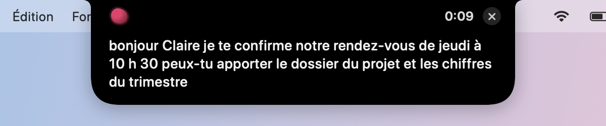

<div align="center">

# Chuchote

**Parlez, c'est écrit.**

[](https://github.com/avialet/chuchote/releases/latest)
[](#installation)
[](LICENSE)

[**Télécharger le DMG**](https://github.com/avialet/chuchote/releases/latest) · [Site](https://chuchote.vialet.app)

</div>

## Ce que fait Chuchote

- **Maintenir, parler, relâcher.** Le texte s’écrit là où se trouve le curseur, dans n’importe quelle app.
- **Rapide et sur votre Mac.** La reconnaissance vocale de macOS tourne en local : rien n’est envoyé.
- **Rester chez vous.** Tout est stocké sur votre Mac. Aucun compte, aucun serveur, aucune télémétrie.



## Installation

**Prérequis :** un Mac Apple Silicon sous macOS 26 (Tahoe) ou plus récent.

1. Téléchargez `Chuchote-X.Y.Z.dmg` depuis la [dernière version](https://github.com/avialet/chuchote/releases/latest).
2. Ouvrez le DMG et glissez **Chuchote** dans **Applications**, puis double-cliquez.
3. Au premier lancement, macOS indique qu'il n'a pas pu vérifier l'app (elle est signée
   sans certificat Apple Developer). Cliquez **Terminé** (pas « Placer dans la corbeille »),
   ouvrez **Réglages Système › Confidentialité et sécurité**, descendez jusqu'à
   « Chuchote a été bloqué… », cliquez **Ouvrir quand même**, authentifiez-vous, puis **Ouvrir**.
   Cette étape n'a lieu qu'une fois par téléchargement. Dans le Terminal :

   ```bash
   xattr -d com.apple.quarantine /Applications/Chuchote.app
   ```

Pour vérifier le fichier téléchargé, comparez son empreinte avec celle publiée dans la même version :

```bash
shasum -a 256 -c Chuchote-X.Y.Z.dmg.sha256
```

### Mises à jour

Chuchote consulte une fois par jour la dernière version publiée sur GitHub. S'il en
existe une plus récente, un clic la télécharge, **vérifie son empreinte SHA-256**, contrôle
l'application qu'elle contient, la remplace et relance l'app. Si une étape échoue, l'app
installée n'est pas touchée. La recherche automatique se désactive dans **Réglages › Mises à jour**.

Le seul échange réseau de Chuchote est cette lecture de la version publiée. Aucune donnée n'est envoyée.

## Utilisation

- **Maintenir pour dicter.** Tenez **⌃⌥Espace** (modifiable dans les Réglages), parlez, relâchez :
  le texte est mis au propre (majuscule, ponctuation, typographie française) puis collé dans l’app
  active. Il reste aussi dans le presse-papiers.
- **La goutte.** Pendant la dictée, une goutte noire sort de l’encoche (en haut au centre sur un écran
  sans encoche) : le blob suit votre voix, le minuteur tourne et le texte s’écrit en direct, pour voir
  ce que Chuchote comprend. Le texte collé vient ensuite du modèle complet, plus précis. La croix ou
  **Échap** annulent. Réglages › Dictée : **Goutte d’encoche** ou **Pilule en bas**, texte en direct ou non.
- **Appui bref : écoute verrouillée.** Un appui court lance l’écoute sans tenir la touche ; un second
  appui termine et colle. **Échap** annule à tout moment, sans rien écrire.
- **Historique.** La fenêtre (Dock, ou **Historique** dans la barre des menus) garde les dernières
  dictées, cherchables. **↩** ou un double-clic recopie une dictée, **⌘⌫** la supprime.
- Fermer la fenêtre ne quitte pas l’app : le raccourci et l’icône de la barre des menus restent actifs.
  **⌘Q** quitte vraiment. Le lien `chuchote://` ouvre la fenêtre principale.

### Autorisations

Tant qu’un point manque, une carte en tête de la fenêtre l’indique, avec le bouton qui le règle.

- **Micro** : demandé à la première dictée. Chuchote n’écoute que pendant que vous dictez
  (l’indicateur orange de macOS s’allume alors, et seulement alors).
- **Accessibilité** (Réglages Système › Confidentialité et sécurité › Accessibilité) : nécessaire au
  collage direct, qui simule ⌘V dans l’app active. Sans elle, le texte attend dans le presse-papiers.
- **Langue** : si le modèle de dictée de la langue choisie n’est pas encore sur le Mac, macOS le
  télécharge une fois, depuis les serveurs d’Apple (bouton **Installer**).

Chaque version porte une nouvelle signature ad hoc : après une mise à jour, si le collage direct ne
fonctionne plus, retirez puis rajoutez Chuchote dans la liste Accessibilité.

### Vos données

```text
~/Library/Application Support/Chuchote/chuchote.sqlite
```

Pour sauvegarder, copiez ce dossier. Pour repartir de zéro, quittez l'app et supprimez-le.

## Compiler depuis les sources

Il faut Swift 6.3 ou plus récent (les Command Line Tools suffisent, Xcode n'est pas nécessaire).

```bash
git clone https://github.com/avialet/chuchote.git
cd chuchote
make test      # tests du noyau
make run       # construit et lance l'app
make install   # installe dans /Applications
make release   # fabrique build/Chuchote-X.Y.Z.dmg et son empreinte
```

L'icône et l'habillage du DMG viennent de l’outillage commun des apps vialet.app
(`scripts/plaque.swift`), cloné à côté de l'app (sinon `VIALETAPPS_PATH=<chemin>`) :

```bash
make icon         # icône : plaque aux teintes de App/Brand.swift, son glyphe (initiale s'il est vide)
make dmg-layout   # fond et disposition de la fenêtre du DMG, dans scripts/dmg (à committer)
```

| Dossier | Contenu |
|---|---|
| `Packages/ChuchoteCore` | Noyau sans interface : modèles, base SQLite ([GRDB](https://github.com/groue/GRDB.swift)), logique |
| `Chuchote` | L'application SwiftUI ; `App/Brand.swift` porte son identité |
| `scripts` | Assemblage de l'app et du DMG ; `scripts/dmg` : fond et disposition de sa fenêtre |
| `docs` | [Publier une version](docs/publier-une-version.md), [tests](docs/tests.md), notes de version |

Le socle commun (mises à jour, thème, raccourci global, panneau flottant) vient de
[VialetKit](https://github.com/avialet/vialetkit). Publier une version ne demande que de
modifier `VERSION` puis de pousser un tag `vX.Y.Z` : la CI construit et publie le DMG, et
les utilisateurs reçoivent la mise à jour dans l'app.

## Confidentialité

Chuchote ne collecte rien. Votre voix et vos dictées ne quittent jamais votre Mac. La seule
requête réseau de l’app est la lecture de la dernière version publiée sur GitHub, que vous pouvez
désactiver ; le modèle d’une langue est téléchargé par macOS lui-même, une fois.

## Licence

[MIT](LICENSE) © 2026 Aurélien Vialet
